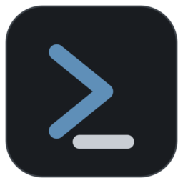
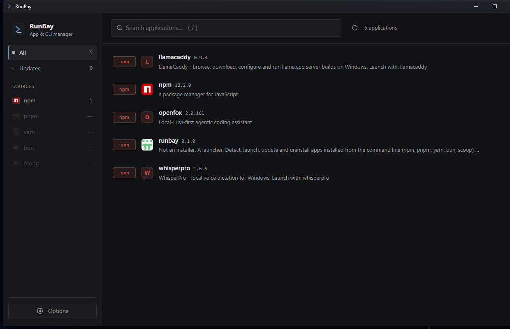
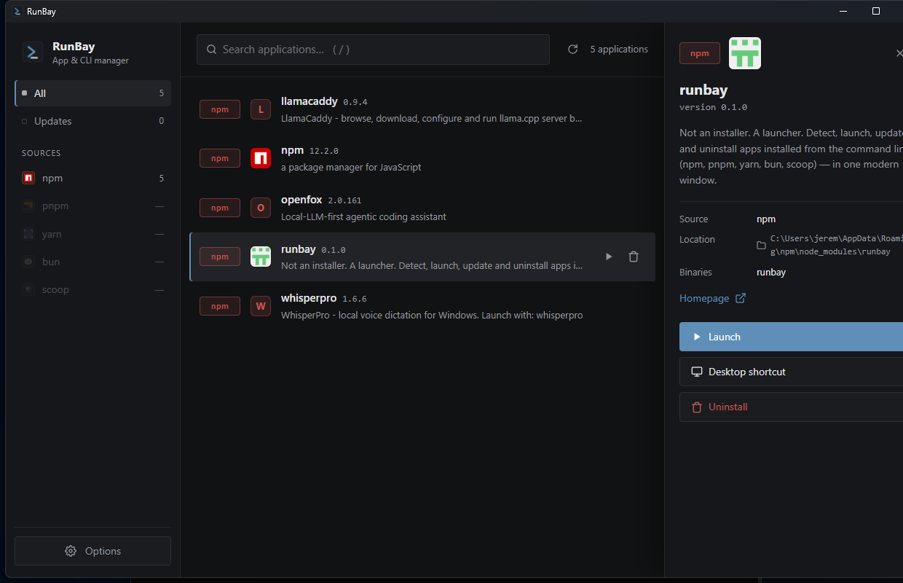
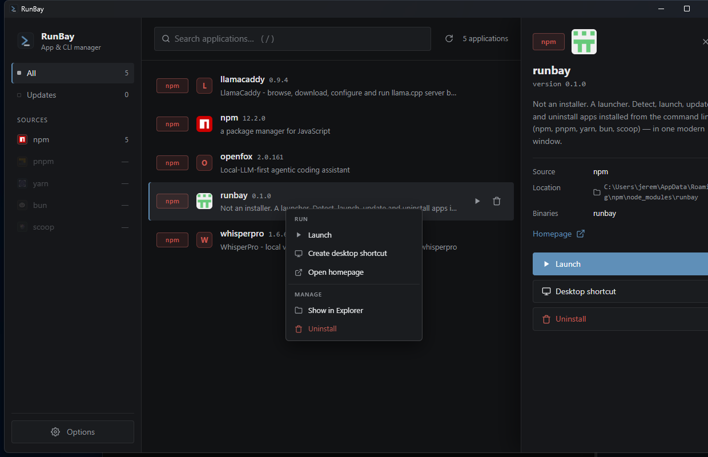
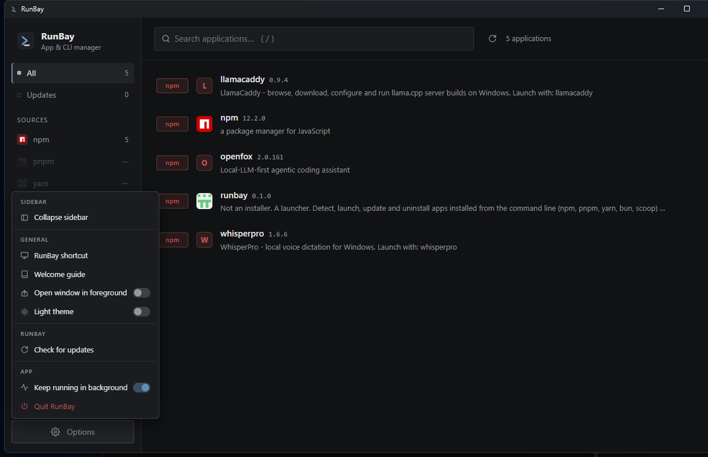

<div align="center">



# RunBay

**Pas un installateur. Un lanceur.**

**Français** · [English](README.en.md)

</div>

Les gestionnaires de paquets installent très bien les choses. Ils sont terribles pour vous montrer ce que vous avez **déjà**, vous permettre de le lancer, et vous dire ce qui n'est pas à jour. **RunBay** corrige ça : il détecte toutes les apps et CLI installées en ligne de commande — **npm, pnpm, yarn, bun, scoop** — et les réunit dans une seule fenêtre, rapide et moderne.

## 🖥️ L'interface



## ✨ Fonctionnalités

- **Détection** de tout ce qui est installé via les gestionnaires réellement présents sur votre machine — rien d'inventé, RunBay lit ce que vos gestionnaires savent déjà
- **Lancement** en un clic — les CLI interactifs s'ouvrent dans une vraie console
- **Mises à jour** uniquement quand une version plus récente existe vraiment — avec *Update all*, et *ignorer cette version* quand la notif devient insistante
- **Désinstallation** avec un vrai dialogue de confirmation, jamais un clic de trop
- **Raccourcis bureau** pour les outils que vous utilisez tous les jours
- **Panneau de détail** : description, page d'accueil, binaires exposés, emplacement d'installation
- **Mode tray** : fermez la fenêtre, RunBay continue de scanner discrètement et vous prévient quand quelque chose peut être mis à jour
- **Thèmes clair et sombre**, barre latérale repliable, recherche instantanée, couleurs par source

## 🔄 RunBay se met à jour tout seul

Quand une nouvelle version arrive sur npm, un point jaune apparaît dans l'app. Un clic : réinstallation et relance automatiques. Plus besoin de penser à `npm update -g`.

## 📦 Sources supportées

| Source | Détection | Lancement | Désinstallation | Mise à jour |
|---|---|---|---|---|
| npm (global) | ✅ | ✅ | ✅ | ✅ |
| pnpm (global) | ✅ | ✅ | ✅ | ✅ |
| yarn v1 (global) | ✅ | ✅ | ✅ | ✅ |
| bun (global) | ✅ | ✅ | ✅ | ✅ |
| scoop | ✅ | ✅ | ✅ | ✅ |

## ⚙️ Installation

> **Prérequis : [Node.js](https://nodejs.org) doit être installé** (version LTS recommandée). C'est indispensable — sans Node.js, RunBay ne peut ni s'installer ni se lancer.

RunBay se distribue via npm (pas d'installeur, pas de SmartScreen) :

```bash
npm install -g runbay
runbay
```

> Depuis npm v12, les scripts d'installation des dépendances sont bloqués par défaut — dont le téléchargement du binaire Electron. Pas d'inquiétude : au premier lancement, RunBay détecte le binaire manquant et exécute lui-même l'installeur officiel d'Electron (téléchargement unique, affiché dans le terminal).

Ou pour essayer une seule fois, sans rien installer :

```bash
npx runbay
```

## 🔧 L'usage au quotidien

Sélectionnez une app pour ouvrir son détail — version, source, emplacement, binaires exposés — puis lancez, créez un raccourci, désinstallez.



Le clic droit ouvre un menu classé par intention : *Run*, *Manage*.



Le bouton **Options** regroupe les réglages : thème, démarrage, tray, guide de bienvenue — et la mise à jour de RunBay lui-même.



## 🧩 Pourquoi « pas un installateur »

Un installateur ajoute des choses à votre machine. Un lanceur vous *amène* à ce que vous avez déjà. RunBay n'installe jamais rien à votre place — il lit ce que npm, pnpm, yarn, bun et scoop savent déjà, et transforme cette liste en un endroit où l'on peut travailler : lancer, mettre à jour, retirer, créer un raccourci. La ligne de commande reste votre outil d'installation ; RunBay est votre outil de lancement.

## 👨‍💻 Développement

```bash
npm install
npm run dev          # l'app avec rechargement à chaud
npm run typecheck    # vérification des types
npm run build        # bundles de production
npm run package:win  # installeur Windows (electron-builder)
```

Chaque source est un **provider** isolé (`src/main/providers/`) : ajouter une nouvelle source = un seul fichier implémentant l'interface `Provider`.

## ☕ Support

[Buy Me a Coffee — skroproduction](https://buymeacoffee.com/skroproduction)

## License

MIT
